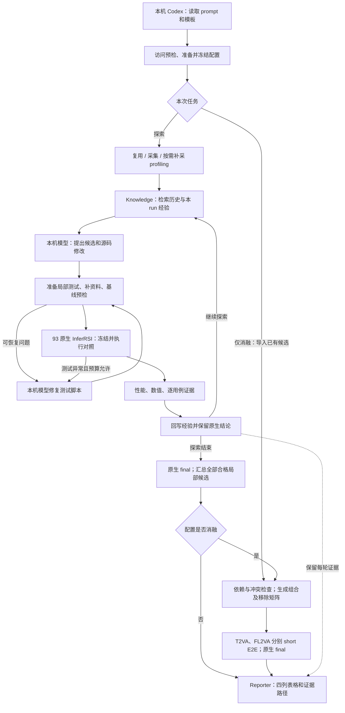

<!-- Public source distribution: site configuration and raw experiment data are intentionally excluded. -->
# InferRSI loop v2

本机 Codex 负责提出优化和修复测试；93 上的原生 InferRSI 负责冻结、对照评测、选优、恢复已有执行记录及最终复测。保留 v1，v2 使用独立目录、容器、虚拟环境和运行记录。默认开启 Knowledge，暂不按性能目标自动停止。

## 架构与复用

| 部分 | 实现与复用 | 输入 → 输出 |
|---|---|---|
| Adapter | 复用本机 Codex、SSH 预检、driver 和 supervisor | prompt、启动配置 → 本机 agent 日志、远端状态 |
| Knowledge | 复用原生 `knowledge search` 和 `knowledge_find.rank`；扩展资料收集与经验回写 | 源码、profiling、手动/loop 历史 → 冻结索引、相关上下文、每轮经验 |
| Protocol | 复用测试生成、回补、预检、H3 脚本；补充任务覆盖及冻结的证据检查入口 | 候选、真实权重/固定输入 → 评测规则和测试脚本 |
| Harness | 原生 `campaign start/diagnose/round/status/recover/final` | 冻结基线、候选及测试 → 原生 assessment、selection、证据 |
| Scheduler | 保留设备锁和有限恢复；扩展兼容 campaign 复用、探索到消融衔接 | 预算、候选清单 → 关联 campaign、消融矩阵 |
| Reporter | 复用飞书同步与回执，改为四列 | 原生结果及证据路径 → 同级 run 小节，保留人工原因 |



外层没有重新实现性能打分或全局最优选择。相同基线、协议内容和指标的候选复用 campaign；换模块/测试口径或修正测试脚本建立关联的新 campaign。不同算子的耗时不混排。“合格候选清单”收集所有满足原生门槛且证据完整的候选，不只收集当前 best。局部候选不等于最终 E2E 验收。

`campaign recover` 收集已有执行结果，不重跑。AB/BA 模式不使用仅限 `service_reuse` 的 `--retry-of/--repair-protocol`。外层不改原生 `state.json`。

## 首次使用

在**本机**打开 Codex CLI，进入本仓库并使用 `skills/inferrsi-loop/SKILL.md`（安装到本机技能目录后可写 `$inferrsi-loop`）。App 也能发起同一任务；需要关闭 App 后持续执行时，使用本机终端启动的 CLI 和 supervisor。本机须持续联网且保持运行。93 不安装模型凭据。

新用户从两个模板建立自己的配置，Codex 可代填并核实，无需手工执行 Python 命令：

- `config/launch.template.json`：本机 SSH/Codex/飞书入口，目标容器、远端 Python/包/运行目录，本机运行目录。
- `config/task.template.json`：目标源码、权重、profile 策略、只读资料、设备、测试规则、预算、Knowledge、后续阶段。

| prompt 中需要说明 | 可以省略 | 可以覆盖 |
|---|---|---|
| 首次使用：目标项目/模型、远端机器和容器、允许卡号、资料位置、实验目的、预算及记录目标；无法在本机发现的连接入口 | 已在用户指定配置中填写的值；没有的可选资料来源直接删掉 | 轮数/时间、卡号、Knowledge on/off、profile 策略、收益门槛、2+2 次数、恢复限制、是否消融及消融时间 |

必须有可核实的源码、权重、推理环境、SSH 指南和实际入口、飞书 CLI/文档。模型与推理强度默认继承发起任务的 Codex 会话。认证在本机配置，不把密钥写入 prompt/仓库/93。模板中的 `<...>` 必须填完；示例个人路径不是通用默认。源码默认整个项目可编辑，包括算子；权重、历史资料及冻结验收规则只读。

运行前 `preflight_access.py --config <launch.json>` 检查个人 SSH 身份和飞书读取。沙箱失败与网络/认证失败分别处理；不自动重置认证。读权限不能证明写权限，写入以同步后的回执为准。独立恢复 CLI 也需在相同权限环境中验证。`run_h3.py` 必须显式传 `--launch-config`，不会回退到旧容器。

## 可粘贴到本机 Codex 的 prompt

首次配置（替换尖括号）：

```text
使用 $inferrsi-loop，在当前仓库从配置模板创建我的配置：
项目/模型 <源码绝对路径、模型名称、权重目录>；目标 <SSH 机器、容器、推理 Python>，卡 <物理编号>；
复用 profiling <文件或文档>，历史资料 <目录/文档>，记录到 <飞书文档>。
全仓库探索 3 个候选，总预算 1 小时；真实权重局部性能和数值验证，2+2，收益门槛 1%，Knowledge on。
请发现并核实本机 SSH、Codex 和飞书入口，展示有效配置后独立执行，不重复无新增依据的失败方案。
```

已有配置继续探索：

```text
使用 $inferrsi-loop，启动配置 <我的 launch.json>，任务基础配置 <我的 task.json>。
新建运行，复用已有 profiling，全仓库探索 3 个候选，1 小时，物理 0–1 卡。
Knowledge on；只做真实权重局部单测及数值验证，避免重复失败方案；完成后同步配置中的飞书文档。
```

先 profiling 再探索：

```text
使用 $inferrsi-loop，读取 <launch.json> 和 <task.json>，创建新运行。
先用已有 torch profiler、xprofiler 采集脚本获得基线，再探索 3 个候选；总预算 <时间>，卡 <编号>。
只做局部性能和数值验证，完成后记录飞书。
```

探索后消融 / 仅消融：

```text
使用 $inferrsi-loop，读取 <launch.json> 和 <task.json>，探索 3 个候选后自动做消融。
总预算 <时间>，其中预留 <时间> 给消融；卡 <编号>。
对兼容候选测基线、全部组合、逐项移除；T2VA 和 FL2VA 分别跑已配置 short request，quality=lossless，2+2。
```

```text
使用 $inferrsi-loop，读取 <launch.json> 和 <task.json>，仅对 <候选清单/文档及补丁路径> 做 short E2E 消融。
卡 <编号>，预算 <时间>；检查依赖冲突，分别报告 T2VA、FL2VA，记录到配置文档。
```

Knowledge 对照可以用同一 skill 和两份新配置：on 使用 0–1，off 使用 2–3，其余基线、事实资料、测试规则、模型和预算一致。`prepare_task.py` 提供 `--knowledge on|off --devices 0,1`；模型不需要自行改脚本。两组有共享主机 CPU/内存干扰时不得声称严格硬件等价。这里支持独立 on/off 运行与证据隔离，**不把两次普通运行自动称为原生 `benchmarks compare` 已验收的对照研究**；原生内置任务没有 H3，本文不声称完成该任务移植。

## 测试与恢复规则

- 探索全部只做局部性能及模块数值验证，不转 short/official E2E。有参数模块加载真实权重；无参数模块允许有源码/模型元数据依据的固定输入，标明真实负载代表性。
- `workload_tasks` 在 H3 配置中为 `t2va/fl2va`。测试脚本声明 `cases` 与 `coverage`：不同布局、分支、权重分别覆盖；确实相同可共用并解释；首帧专属模块注明 T2VA 不适用。每个用例保留原始 samples/数值结果，不只报告汇总。
- 2 次预热、2 次测量由测试脚本执行；原生外层 `warmups=0,repetitions=1`。两次样本不证明统计显著性。收益门槛是候选筛选规则，不是探索停止目标。
- 优先原有模块 CI；无适用规则时 `exact_or_review`。无差异可通过，非零差异待确认；不自动放宽阈值。冻结的证据检查脚本在原生评测内验证 provenance、次数、用例完整性；缺证据是 INCONCLUSIVE。
- `local_recovery.max_evidence_rounds=6`，按批计；UTF-8 `.log` 等单文件最多 2 MiB；`max_protocol_versions=4`。修复保留原输入、数值门槛及旧证据，先基线预检，再评测。
- 数值失败或无收益记录结论后继续；候选缺资料/测试异常耗尽预算标“未测量”，不阻止其他候选。SSH/权限/设备等全局问题有限恢复，未恢复保留状态。
- 候选数、评测尝试、有效实验、合格候选分别统计。时间预算含修复；原生 final 有预留，不能用完搜索时间后假称完成最终复测。
- `workflow.after_explore=ablate` 时需提前配置 `ablation_stages` 和 `ablation_max_seconds`（包含在总时间内）。复用 `ablation.py`，按独立补丁组合，冲突/依赖不满足记录排除原因。只有一个合格项做基线对照；没有则跳过。二进制改动需显式构建好消融版本。
- 原生 FAIL 的逐项移除对照可能表示“移除后变慢”，不能据此判该项无效；记录组合内贡献。short E2E 只做既有 functional 校验，完整模型质量/官方请求验收是单独阶段。

## Knowledge 与上下文

默认 `knowledge.enabled=true`。手动优化文档、未写入文档的原始实验、loop 记录、当前源码和历史版本均可列入 `knowledge_sources`。冻结 `catalog.json/coverage.json`，保留版本、出处和未读部分。旧环境仅提供线索，不冒充新环境布局或性能证据。

每轮 `knowledge/content/*.json` 追加候选、尝试原因、环境/基线、范围、结论与原始证据路径；下一轮通过原生 rank 检索相关经验，不拼接完整对话。新运行要在 `knowledge_sources` 指向前序运行根目录；H3 v2 示例已配置。这里迭代的是有证据的经验和后续优化选择，不是训练模型权重，也不自动改 skill。

off 会同时清除外部知识源、历史文件和混合参考包，关闭原生 campaign Knowledge；回补仅允许源码、权重及 `knowledge.factual_evidence_roots`。保留共同 profiling/任务事实及本 run 反馈。Planner、测试生成和恢复都遵守此开关；两组运行目录不得相互作为事实根目录。

## 独立运行、进度与记录

Codex 根据 prompt 准备新任务配置，再调用已有 `supervise_h3.py → run_h3.py → local_driver.py`。监督进程保存 `task.txt`、配置、PID、日志和恢复决定；关闭 App 后可继续。受限权限、认证过期、主机休眠/断网不会自动消失，超过预算明确留待处理。内层模型的活动以 agent JSONL 日志为准。

本机运行目录可看 `supervisor.log`、`supervisor-status.json`、`remote-status.json`；远端看 `summary.json`、`candidate-optimizations.json`、`campaigns/`。实验结束统一收集并同步，实时进度来自日志/状态文件，飞书不是实时控制台。同步失败只补传，不重复跑实验。

每个 run 在飞书新建同级 h2，包含 Asia/Shanghai 时间、run ID、Knowledge on/off。固定四列：

| 优化项 | 尝试原因 | 实测结果 | 结论 |
|---|---|---|---|
| 改动及局部用例/任务 | 一句瓶颈依据与预期作用 | 基线→候选、收益、数值结果 | 候选/无收益/数值失败/未测量及原因 |

证据使用含 run ID 的 `results.json`、补丁和原生评测绝对路径。重复同步只更新本 run；人工补充的原因保存在 `report-notes.json`，不会被后续生成覆盖。完整过程保留 JSON/日志，不另建 Markdown 实验报告。

## 继承当前会话的模型与推理强度

在本机 Codex CLI 选好 model/强度后直接输入 README 中的 prompt。无需在启动与任务配置重复填写。优先级按字段为：命令行显式覆盖 > launch 可选覆盖 > task 可选覆盖 > 当前会话。省略或 null 表示继承；例如只覆盖模型时，强度继续继承。

后台启动前保存 `parent-session.json`；初始化时生成 `model-selection.json`，记录最终 model/effort 及来源，并传到93冻结配置。Planner、测试生成和 supervisor 恢复均使用同一选择。运行中更换外层模型不会改变已启动实验；改变模型请新建运行。旧运行继续用旧版本代码和冻结配置。

读取限于本机 Codex 状态库中当前 thread 的 rollout 路径及模型/强度元数据，不读取认证文件，不修改 provider/base_url。该元数据接口可能随 Codex 版本改变；找不到当前会话或缺少字段会明确报错，不静默回退。在普通终端直接运行脚本、没有当前 Codex 会话时，需显式提供 `--model`、`--effort`，或填写可选配置。无需改配置中的认证信息。

## v3 与 blocked 修复

v2 保留非目标用法；目标驱动使用 `inferrsi-loop-v3` 分支中的本扩展和其 objective 模板，旧运行不迁移。v2 同步修复合法 blocked 状态被当成 CLI 错误的问题，并核对原生保留源码快照。未完成项保留失败记录；只有通过数值、性能及独立复测的候选进入消融，同一 campaign 的非 best 候选另用原生评测确认。旧冻结运行仍须使用原代码恢复。

## Public distribution and validation

This directory is an optional extension; it does not replace native InferRSI. Install it in its own environment with `python -m pip install -e .`. Run its CPU orchestration checks with `PYTHONPATH=src python -m unittest discover -s tests -q`. These checks do not establish H3 accelerator performance or output quality. Native InferRSI remains pinned by pyproject.toml.

Personal deployment JSON, historical source copies, model metadata, raw runs and site bootstrap/replay utilities are excluded. `config/examples/synthetic.launch.json` is a test fixture, not a real deployment. Fill the configuration templates for your own environment. The optional legacy H3 collector has labelled site placeholders; provide your existing collector through the generic profile command interface or adapt those explicit legacy match strings to your frozen script bundle before use. No credentials are stored in this package.
